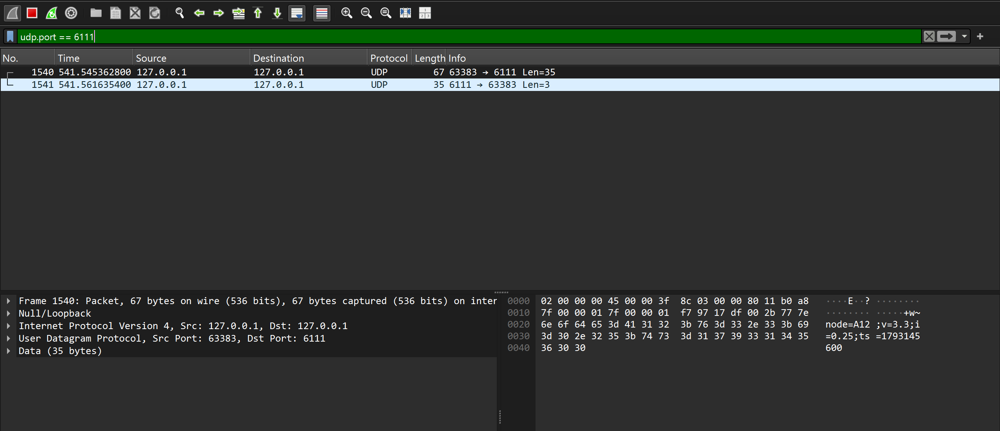
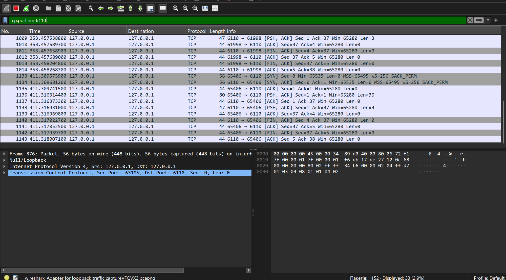
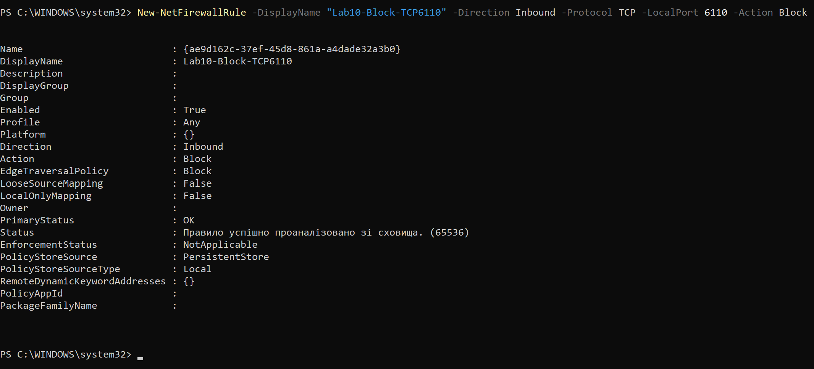
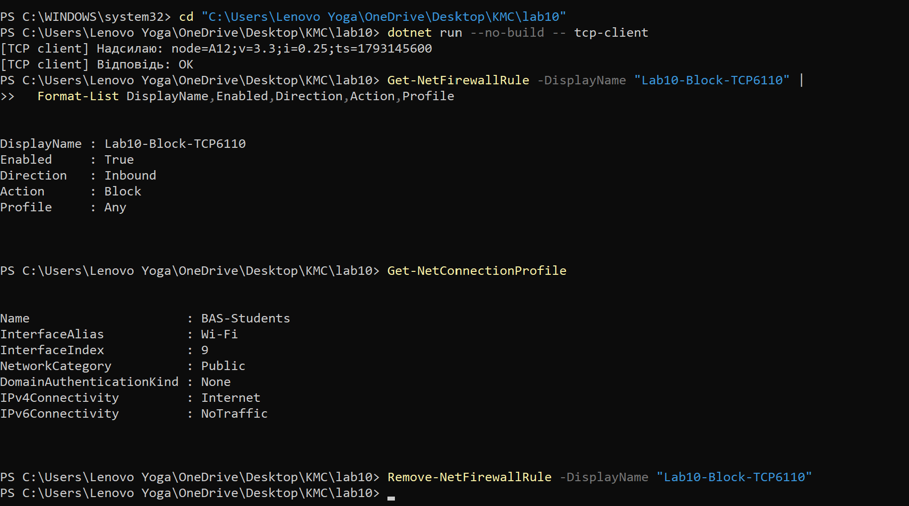
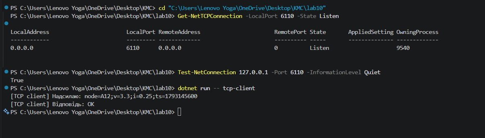
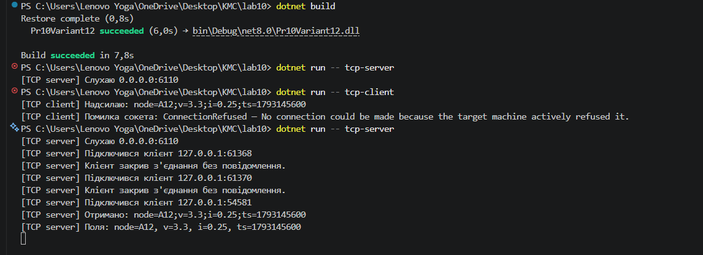
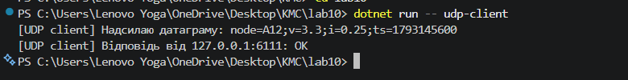
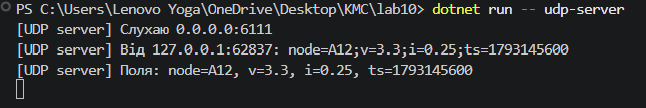

# Практична робота №10 — Варіант 12
## Інтеграційна робота: клієнт-серверний обмін по TCP і UDP та аналіз трафіку

**Варіант:** 12  
**Поля повідомлення:** `node`, `v`, `i`, `ts`  
**TCP-порт:** `6110`  
**UDP-порт:** `6111`  
**Сценарій порушення зв’язку:** блокування порту брандмауером.


## 1. Мета роботи

Метою роботи є реалізація та дослідження клієнт-серверного обміну даними за допомогою протоколів TCP і UDP, перевірка передавання повідомлень заданого формату, аналіз мережевого трафіку у Wireshark та дослідження поведінки застосунку за умов обмеження мережевого доступу.

Під час виконання роботи необхідно порівняти принципи роботи TCP і UDP, дослідити заголовки транспортного рівня, встановлення та завершення TCP-з’єднання, передавання UDP-датаграм і поведінку застосунку в разі проблем із мережевим обміном.

## 2. Вихідні дані варіанта 12

| Параметр | Значення |
|---|---|
| Номер варіанта | 12 |
| Мова програмування | C# |
| Платформа | .NET 8 |
| Формат повідомлення | `key=value;key=value;...` |
| Поле 1 | `node` |
| Поле 2 | `v` |
| Поле 3 | `i` |
| Поле 4 | `ts` |
| TCP-порт сервера | `6110` |
| UDP-порт сервера | `6111` |
| Сценарій порушення | Блокування порту брандмауером |

Приклад повідомлення, що використовується під час тестування:

`node=A12;v=3.3;i=0.25;ts=1793145600`

У повідомленні `node` позначає ідентифікатор вузла, `v` — значення напруги, `i` — значення струму, а `ts` — часову позначку.

## 3. Структура проєкту

Проєкт реалізовано мовою C# з використанням .NET.

Основні файли:

- `lab10.csproj` — файл проєкту .NET.
- `Program.cs` — точка входу та вибір режиму роботи застосунку.
- `AppOptions.cs` — обробка параметрів командного рядка.
- `Protocol.cs` — формування, розбір і перевірка повідомлень.
- `TcpServer.cs` — реалізація TCP-сервера.
- `TcpClientApp.cs` — реалізація TCP-клієнта.
- `UdpServer.cs` — реалізація UDP-сервера.
- `UdpClientApp.cs` — реалізація UDP-клієнта.
- `README.md` — інструкції з компіляції, запуску й тестування.

Програма підтримує чотири режими роботи: TCP-сервер, TCP-клієнт, UDP-сервер та UDP-клієнт.

## 4. Вимоги та підготовка середовища

Для запуску проєкту потрібен встановлений .NET SDK, сумісний із цільовою платформою .NET 8.

Перевірка встановлення SDK:

```powershell
dotnet --info
```

Перехід до каталогу проєкту:

```powershell
cd "C:\Users\Lenovo Yoga\OneDrive\Desktop\KMC\lab10"
```

Компіляція проєкту:

```powershell
dotnet build
```

Під час виконання роботи компіляція завершилася успішно, помилок збірки не було.

## 5. Реалізація та перевірка TCP-обміну

TCP забезпечує надійний упорядкований потік байтів між клієнтом і сервером. Перед передаванням прикладних даних встановлюється з’єднання, а отримання даних підтверджується механізмами протоколу.

Для локального тестування TCP-сервер використовує порт `6110`. Клієнт за замовчуванням підключається до адреси `127.0.0.1`.

### 5.1. Запуск TCP-сервера

У першому вікні PowerShell у каталозі проєкту виконується:

```powershell
dotnet run --no-build -- tcp-server
```

Очікуване повідомлення про запуск:

```text
[TCP server] Слухаю 0.0.0.0:6110
```

Сервер потрібно залишити запущеним.

### 5.2. Запуск TCP-клієнта

В іншому вікні PowerShell виконується:

```powershell
dotnet run --no-build -- tcp-client
```

Під час успішного тесту клієнт вивів:

```text
[TCP client] Надсилаю: node=A12;v=3.3;i=0.25;ts=1793145600
[TCP client] Відповідь: OK
```

На стороні сервера зафіксовано отримання повідомлення та розбір його полів:

```text
[TCP server] Отримано: node=A12;v=3.3;i=0.25;ts=1793145600
[TCP server] Поля: node=A12, v=3.3, i=0.25, ts=1793145600
```

Отже, локальний TCP-обмін успішно перевірено: клієнт передав повідомлення, сервер отримав і розібрав його та повернув відповідь `OK`.

## 6. Реалізація та перевірка UDP-обміну

UDP передає дані окремими датаграмами без попереднього встановлення транспортного з’єднання. Сам протокол не гарантує доставку, порядок надходження або повторне передавання втрачених датаграм.

Для UDP-обміну використовується порт `6111`.

### 6.1. Запуск UDP-сервера

У першому вікні PowerShell виконується:

```powershell
dotnet run --no-build -- udp-server
```

Повідомлення про запуск:

```text
[UDP server] Слухаю 0.0.0.0:6111
```

### 6.2. Запуск UDP-клієнта

В іншому вікні PowerShell виконується:

```powershell
dotnet run --no-build -- udp-client
```

Під час успішного тесту отримано:

```text
[UDP client] Надсилаю датаграму: node=A12;v=3.3;i=0.25;ts=1793145600
[UDP client] Відповідь від 127.0.0.1:6111: OK
```

На стороні сервера зафіксовано отримання датаграми та розбір полів:

```text
[UDP server] Від 127.0.0.1:62837: node=A12;v=3.3;i=0.25;ts=1793145600
[UDP server] Поля: node=A12, v=3.3, i=0.25, ts=1793145600
```

Таким чином, локальний UDP-обмін успішно перевірено. Сервер отримав датаграму, розібрав повідомлення та повернув відповідь `OK`.

## 7. Аналіз мережевого трафіку у Wireshark

Для дослідження мережевого обміну використано Wireshark 4.6.9 та Npcap. Оскільки клієнти й сервери запускалися на одному комп’ютері, захоплення виконувалося на інтерфейсі `Adapter for loopback traffic capture`.

### 7.1. Аналіз TCP

Для відображення пакетів TCP використано фільтр:

```text
tcp.port == 6110
```

Для пошуку пакетів із прапорцем SYN:

```text
tcp.flags.syn == 1
```

Для пошуку TCP-сегментів, що містять дані:

```text
tcp.port == 6110 && tcp.len > 0
```

Під час аналізу захоплення спостерігалися TCP-пакети між адресами `127.0.0.1` і `127.0.0.1`. У списку пакетів видно прапорці `SYN`, `SYN, ACK`, `ACK`, `PSH, ACK` та `FIN, ACK`.

Ці пакети відповідають встановленню TCP-з’єднання, передаванню даних і завершенню обміну. Наявність пакетів із прикладними даними можна перевірити за полем `Len` у стовпці `Info` та вмістом пакета.

### 7.2. Аналіз UDP

Для відображення UDP-датаграм використано фільтр:

```text
udp.port == 6111
```

У захопленні зафіксовано два пакети:

- датаграма від клієнта до сервера: порт джерела `63383`, порт призначення `6111`, довжина кадру 67 байтів;
- відповідь сервера клієнту: порт джерела `6111`, порт призначення `63383`, довжина кадру 35 байтів.

У вмісті першої датаграми видно текст:

`node=A12;v=3.3;i=0.25;ts=1793145600`

Отже, Wireshark підтвердив передавання прикладного повідомлення через UDP та повернення відповіді сервером.

### 7.3. Заголовки мережевого та транспортного рівнів

Для IPv4 без додаткових опцій стандартний заголовок IP має розмір 20 байтів. Мінімальний заголовок TCP також має 20 байтів, але може бути більшим через TCP-опції. Заголовок UDP має фіксований розмір 8 байтів.

Під час аналізу конкретного пакета необхідно враховувати фактичні значення, які відображає Wireshark, оскільки розмір кадру залежить від заголовків і довжини переданих даних.
# СКРІНИ ВИКОНАННЯ ПРАКТИЧНОЇ










## 8. Сценарій варіанта 12 — блокування порту брандмауером

Для перевірки сценарію порушення зв’язку було створено правило Windows Defender Firewall, яке блокує вхідні TCP-з’єднання на порт `6110`.

Команда створення правила:

```powershell
New-NetFirewallRule -DisplayName "Lab10-Block-TCP6110" -Direction Inbound -Protocol TCP -LocalPort 6110 -Action Block
```

Після створення правила було перевірено його параметри. У результаті підтверджено, що правило було увімкнене, мало напрямок `Inbound`, дію `Block` і профіль `Any`.

Після цього TCP-клієнт було запущено повторно. Фактичний результат:

```text
[TCP client] Надсилаю: node=A12;v=3.3;i=0.25;ts=1793145600
[TCP client] Відповідь: OK
```

Отже, попри створене правило, локальне TCP-з’єднання продовжило працювати. Фактичне блокування з’єднання в цьому експерименті не підтверджено. Тому не можна стверджувати, що перевірка завершилася успішним блокуванням порту.

Після тестування створене правило було видалено командою:

```powershell
Remove-NetFirewallRule -DisplayName "Lab10-Block-TCP6110"
```

Це повернуло налаштування брандмауера до стану до виконання цього експерименту щодо створеного правила.

Для повного підтвердження сценарію блокування необхідно повторити тест у контрольованому мережевому середовищі, наприклад між двома вузлами або у Linux-віртуальній машині, та зафіксувати фактичну поведінку клієнта й мережевий трафік. Тестування на Linux-віртуальній машині в межах наведених результатів не підтверджено.

## 9. Таблиця спостережень

У таблиці наведено результати локальних тестів і характеристики протоколів. Кількість пакетів залежить від конкретного сеансу, тому для точного підрахунку потрібно враховувати пакети у власному захопленні Wireshark.

| Показник | TCP | UDP |
|---|---|---|
| Порт сервера | 6110 | 6111 |
| Адреса під час локального тесту | `127.0.0.1` | `127.0.0.1` |
| Передавання повідомлення | Успішне | Успішне |
| Відповідь сервера | `OK` | `OK` |
| Формат прикладного повідомлення | `node=A12;v=3.3;i=0.25;ts=1793145600` | `node=A12;v=3.3;i=0.25;ts=1793145600` |
| Заголовок транспортного рівня | Мінімум 20 байтів, можливі TCP-опції | 8 байтів |
| Встановлення з’єднання | Тристороннє рукостискання | Не виконується |
| Підтвердження доставки на рівні протоколу | Є механізми ACK і повторної передачі | Немає |
| Результат локального тесту | Успішний обмін | Успішний обмін |
| Результат тесту блокування TCP/6110 | Правило створено, але клієнт отримав `OK`; блокування не підтверджено | Не тестувалося в межах сценарію блокування |

## 10. Пояснення спостережень

TCP використовує тристороннє рукостискання для встановлення з’єднання, а також механізми підтвердження приймання даних і повторної передачі. Це збільшує кількість службових пакетів, але забезпечує надійний упорядкований потік байтів. UDP передає дані окремими датаграмами без встановлення з’єднання та без протокольного підтвердження доставки, тому має менші накладні витрати. У проведених локальних тестах обидва протоколи успішно передали повідомлення й отримали відповідь `OK`, тоді як сценарій фактичного блокування TCP-порту не підтвердився.

## 11. Контрольні запитання

### 1. Чому TCP має додаткові пакети, а UDP — ні?

TCP встановлює з’єднання за допомогою тристороннього рукостискання `SYN`, `SYN-ACK`, `ACK`. Крім того, TCP використовує підтвердження приймання даних і механізми повторної передачі. UDP не встановлює з’єднання перед передаванням датаграм.

### 2. Як побачити рукостискання TCP у Wireshark?

Для пошуку TCP-пакетів із прапорцем SYN можна застосувати фільтр:

```text
tcp.flags.syn == 1
```

Початковий пакет клієнта має прапорець SYN, а відповідь сервера зазвичай містить SYN та ACK. Наступний ACK завершує тристороннє рукостискання.

### 3. Чому заголовок UDP менший за заголовок TCP?

Заголовок UDP має 8 байтів і містить порти джерела й призначення, довжину та контрольну суму. TCP має додаткові поля для керування з’єднанням, нумерації байтів, підтверджень, прапорців і керування потоком. Тому мінімальний заголовок TCP становить 20 байтів.

### 4. Чому UDP-клієнт не отримує миттєву помилку після зупинки сервера?

UDP не встановлює стан транспортного з’єднання та не гарантує доставку датаграми. Тому відсутність сервера не обов’язково призводить до негайної помилки на стороні клієнта. Якщо клієнт очікує відповідь, він може виявити проблему за тайм-аутом, реалізованим у застосунку.

### 5. Чому формат повідомлення однаковий для TCP і UDP?

Формат `key=value;key=value;...` належить до прикладного рівня. TCP і UDP забезпечують передавання даних транспортним рівнем, але не визначають формат прикладного повідомлення. Тому однакові дані можна передавати обома протоколами.

### 6. Для чого потрібен порт?

Порт дає змогу операційній системі спрямовувати мережеві дані до відповідного процесу або сокета на вузлі. У цій роботі TCP-сервер використовує порт `6110`, а UDP-сервер — порт `6111`.

## 12. Домашнє завдання

TCP перед передаванням прикладних даних виконує тристороннє рукостискання. Клієнт надсилає `SYN`, сервер відповідає `SYN-ACK`, а клієнт завершує встановлення з’єднання повідомленням `ACK`. Цей процес узгоджує стан з’єднання та початкові параметри, але додає службові сегменти й затримку перед передаванням даних.

UDP не встановлює з’єднання, тому передавання може починатися без тристороннього рукостискання. Водночас UDP не гарантує доставку, порядок надходження або повторне передавання датаграм.

У разі проблем із TCP-з’єднанням клієнт може отримати відмову в підключенні, скидання з’єднання або тайм-аут — залежно від причини проблеми. UDP не має аналогічної сигналізації стану з’єднання. Виявлення відсутності відповіді потребує додаткової логіки на прикладному рівні.

## 13. Висновок

Під час виконання практичної роботи №10 для варіанта 12 було реалізовано клієнт-серверний обмін повідомленнями мовою C# на платформі .NET. Для TCP використано порт `6110`, а для UDP — порт `6111`. Формат прикладного повідомлення містить поля `node`, `v`, `i` та `ts`, розділені символом `;`.

Компіляція проєкту завершилася успішно. Під час локального тестування TCP-клієнт передав повідомлення серверу та отримав відповідь `OK`. Аналогічно UDP-клієнт успішно передав датаграму, а сервер повернув відповідь `OK`. У Wireshark було зафіксовано TCP-трафік, зокрема пакети встановлення та завершення з’єднання, а також UDP-датаграму з прикладним повідомленням і відповідь сервера.

Було створено правило брандмауера для блокування вхідних TCP-з’єднань на порт `6110`, проте клієнт продовжив отримувати відповідь `OK`, тому фактичне блокування локального з’єднання не підтверджено. Створене правило після експерименту видалено.

У результаті роботи досліджено відмінності між TCP і UDP, перевірено передавання даних обома протоколами та проаналізовано відповідні пакети у Wireshark. Основні функціональні вимоги локального клієнт-серверного обміну виконано; сценарій блокування порту потребує додаткової перевірки в контрольованому мережевому середовищі.