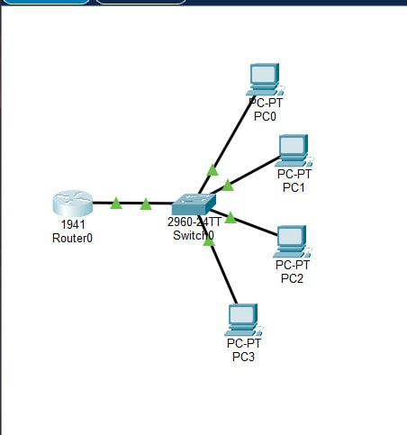
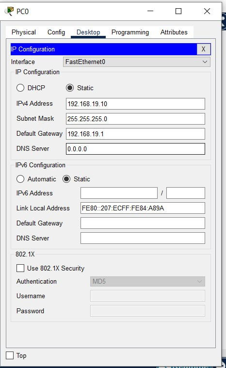
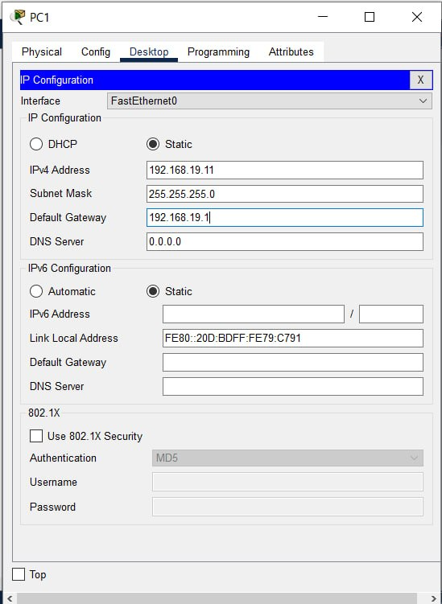
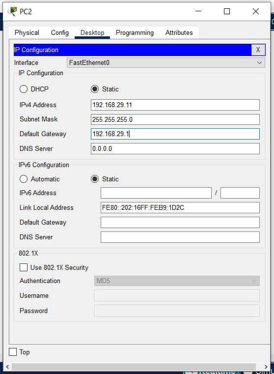
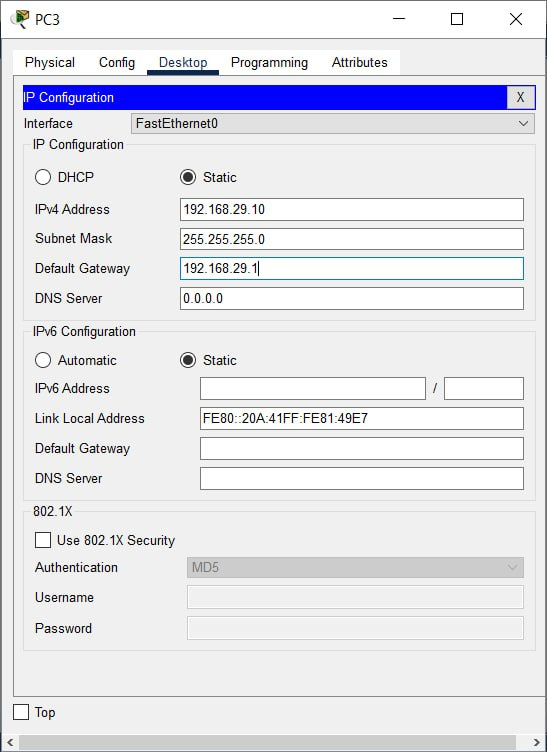
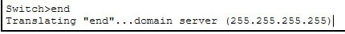
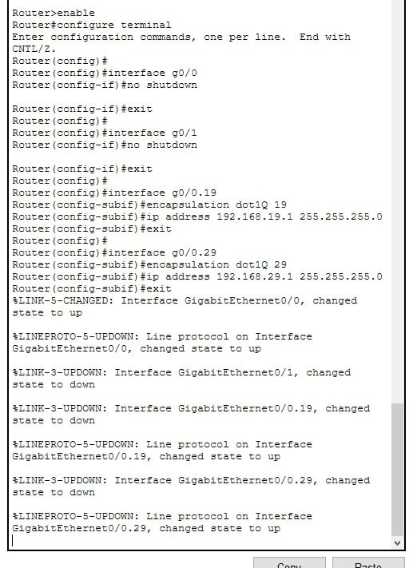
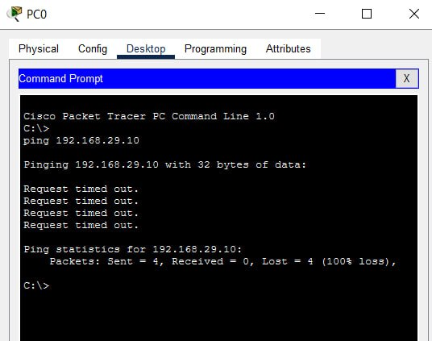

# Практична робота №7: Комутація, VLAN і міжмережева взаємодія

* **Варіант:** №12
* **Інструмент:** Cisco Packet Tracer


## 1. Мета роботи

Опанувати навички створення та налаштування віртуальних локальних мереж (VLAN) на комутаторі Cisco 2960, перевірити їх ізоляцію на канальному (L2) рівні та реалізувати міжмережеву маршрутизацію між VLAN за допомогою технології **Router-on-a-Stick** на маршрутизаторі Cisco 1941.


## 2. Топологія мережі та адресація

### Схема топології
()

### Таблиця адресації та розподілу портів (Варіант 12)

| Вузол / Пристрій | Інтерфейс / Порт | VLAN / Назва | IP-адреса | Маска підмережі | Основний шлюз |
| :--- | :--- | :--- | :--- | :--- | :--- |
| **PC0** | Fa0 $\rightarrow$ Switch Fa0/1 | VLAN 19 (HR) | `192.168.19.10` | `255.255.255.0` | `192.168.19.1` |
| **PC1** | Fa0 $\rightarrow$ Switch Fa0/2 | VLAN 19 (HR) | `192.168.19.11` | `255.255.255.0` | `192.168.19.1` |
| **PC3** | Fa0 $\rightarrow$ Switch Fa0/3 | VLAN 29 (DEV) | `192.168.29.10` | `255.255.255.0` | `192.168.29.1` |
| **PC2** | Fa0 $\rightarrow$ Switch Fa0/4 | VLAN 29 (DEV) | `192.168.29.11` | `255.255.255.0` | `192.168.29.1` |
| **Router0** | Gi0/0.19 | Subinterface VLAN 19 | `192.168.19.1` | `255.255.255.0` | — |
| **Router0** | Gi0/0.29 | Subinterface VLAN 29 | `192.168.29.1` | `255.255.255.0` | — |

---

## 3. Конфігурація обладнання в CLI

### Налаштування мережевих параметрів ПК


* **PC0 IP Configuration:**  

* **PC1 IP Configuration:**  

* **PC2 IP Configuration:**  

* **PC3 IP Configuration:**  



### Налаштування комутатора (Switch0)


```cisco
Switch> enable
Switch# configure terminal

! Створення VLAN для Варіанта 12
Switch(config)# vlan 19
Switch(config-vlan)# name HR
Switch(config-vlan)# vlan 29
Switch(config-vlan)# name DEV
Switch(config-vlan)# exit

! Налаштування портів доступу (Access) для VLAN 19 (HR)
Switch(config)# interface range fa0/1 - 2
Switch(config-if-range)# switchport mode access
Switch(config-if-range)# switchport access vlan 19
Switch(config-if-range)# exit

! Налаштування портів доступу (Access) для VLAN 29 (DEV)
Switch(config)# interface range fa0/3 - 4
Switch(config-if-range)# switchport mode access
Switch(config-if-range)# switchport access vlan 29
Switch(config-if-range)# exit

! Налаштування транкового порту (Trunk) до роутера
Switch(config)# interface g0/1
Switch(config-if)# switchport mode trunk
Switch(config-if)# exit
```
### Налаштування маршрутизатора (Router0)



## 4. Результати перевірки та тестування

Таблиця VLAN на комутаторі (show vlan brief)


| VLAN ID | VLAN Name       | Status    | Ports                  |
|---------|-----------------|-----------|------------------------|
| 1       | default         | active    | Fa0/5-24, Gi0/2         |
| 19      | HR              | active    | Fa0/1, Fa0/2            |
| 29      | DEV             | active    | Fa0/3, Fa0/4            |
| 1002    | fddi-default    | act/unsup | —                      |
| 1003    | token-ring-default | act/unsup | —                   |
| 1004    | fddinet-default | act/unsup | —                      |
| 1005    | trnet-default   | act/unsup | —                      |
### Результати перевірки ping


1. **До налаштування Router-on-a-Stick:**
   - **PC0 (192.168.19.10) → PC1 (192.168.19.11)** *(у межах VLAN 19)* — **Успішно** (`Reply from 192.168.19.11`).
   - **PC0 (192.168.19.10) → PC3 (192.168.29.10)** *(між VLAN 19 та VLAN 29)* — **Помилка** (`Request timed out`).

   **Пояснення:** Комутатор розділяє мережу на ізольовані широкомовні домени. На канальному рівні (L2) трафік між різними VLAN не маршрутизується.

2. **Після налаштування Router-on-a-Stick та шлюзів на ПК:**
   - **PC0 (192.168.19.10) → PC3 (192.168.29.10)** — **Успішно** (`Reply from 192.168.29.10`).

## 5. Висновки

Розділення комутатора на **VLAN 19** та **VLAN 29** створило два незалежні широкомовні домени, що унеможливило прямий обмін даними між ними на канальному рівні. Зв'язок між пристроями з різних підмереж з'явився після додавання маршрутизатора та налаштування субінтерфейсів з інкапсуляцією `dot1Q` за технологією **Router-on-a-Stick**.

Передавання пакетів між різними IP-мережами потребує маршрутизації на мережевому рівні (L3).

## 6. Відповіді на контрольні запитання

**1. Як комутатор наповнює таблицю MAC-адрес і що робить із кадром невідомого призначення?**

Комутатор автоматично наповнює таблицю MAC-адрес, аналізуючи MAC-адресу відправника (*Source MAC*) у кожному вхідному кадрі та пов'язуючи її з портом, на який надійшов кадр. Якщо MAC-адреса призначення невідома (*Unknown Unicast*), комутатор розсилає кадр на всі порти відповідного VLAN, крім вхідного. Цей процес називається *Flooding*.

**2. Чому широкомовний кадр однієї VLAN не потрапляє в іншу VLAN на тому самому комутаторі?**

VLAN логічно розділяє комутатор на окремі широкомовні домени. Тому комутатор пересилає широкомовні кадри лише в межах VLAN, до якої вони належать.

**3. Чим порт доступу відрізняється від транкового за призначенням і форматом кадру?**

- **Access-порт:** призначений для підключення кінцевих пристроїв, наприклад ПК. Належить до однієї VLAN і зазвичай передає Ethernet-кадри без тегів.
- **Trunk-порт:** використовується для з'єднання мережевих пристроїв, наприклад комутатора з маршрутизатором або іншого комутатора. Передає трафік кількох VLAN, використовуючи теги IEEE 802.1Q для ідентифікації VLAN.

**4. Що таке тег IEEE 802.1Q і навіщо він потрібен на транку?**

IEEE 802.1Q — це стандарт тегування Ethernet-кадрів, який додає до кадру 4-байтове поле з інформацією про VLAN, зокрема VLAN ID. Тег дає змогу пристрою на іншому кінці транкового з'єднання визначити, до якої віртуальної мережі належить кадр.

**5. Порівняйте Router-on-a-Stick і SVI як способи міжVLAN-маршрутизації.**

- **Router-on-a-Stick:** використовує один фізичний канал між комутатором і зовнішнім маршрутизатором. Для кожної VLAN налаштовується окремий субінтерфейс, наприклад `G0/0.19` і `G0/0.29`, з інкапсуляцією IEEE 802.1Q.
- **SVI (Switch Virtual Interface):** використовує віртуальні інтерфейси VLAN на комутаторі третього рівня (L3). Маршрутизація виконується безпосередньо комутатором, що зазвичай забезпечує вищу продуктивність.

**6. Чому до налаштування маршрутизації вузли різних VLAN не обмінювалися пакетами, хоча були підключені до одного комутатора?**

Пристрої перебували в різних IP-підмережах (`192.168.19.0/24` та `192.168.29.0/24`). Звичайний комутатор другого рівня (L2) не виконує маршрутизацію між цими мережами, а VLAN ізолюють трафік на канальному рівні. Для обміну пакетами потрібен маршрутизатор або L3-комутатор.

## 7. Домашнє завдання (осмислення результату)

### Широкомовний кадр проти звичайного

Широкомовний Ethernet-кадр має MAC-адресу призначення `FF:FF:FF:FF:FF:FF` і надсилається всім вузлам відповідного широкомовного домену. Комутатор пересилає його на всі відповідні порти поточного VLAN, крім вхідного.

Звичайний кадр, адресований конкретному пристрою, пересилається на порт, який відповідає MAC-адресі призначення в таблиці *MAC Address Table*. Якщо адреса невідома, комутатор виконує *Flooding* у межах відповідного VLAN.

### Причина ізоляції ARP-запитів між VLAN та спосіб її усунення

ARP-запит є широкомовним кадром. Комутатор обмежує його розповсюдження межами відповідної VLAN, тому ARP-запит із VLAN 19 не потрапляє безпосередньо до VLAN 29.

Для забезпечення зв'язку між цими VLAN потрібно налаштувати маршрутизацію між ними за допомогою маршрутизатора з субінтерфейсами IEEE 802.1Q (Router-on-a-Stick) або L3-комутатора. Також на кінцевих пристроях необхідно налаштувати правильні IP-адреси, маски підмережі та шлюзи за замовчуванням.