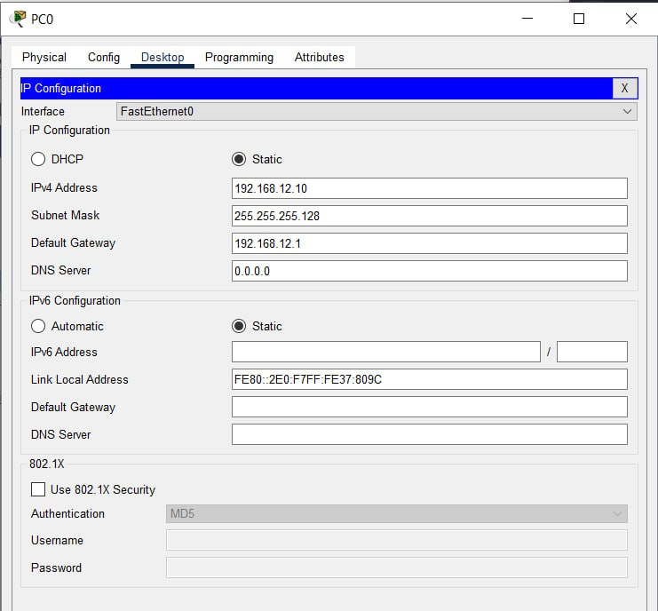
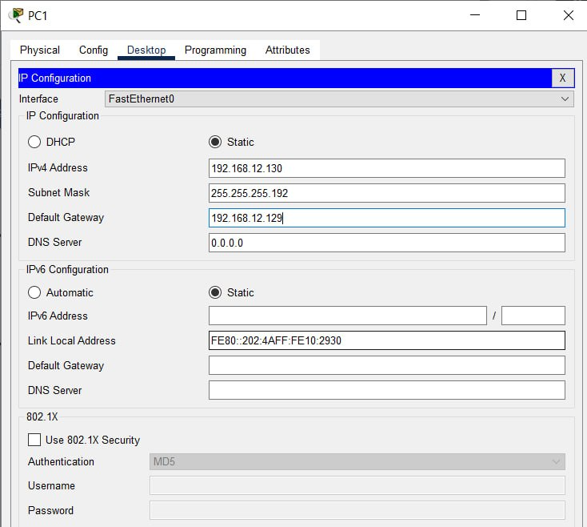
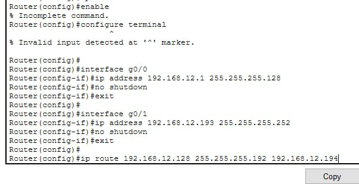
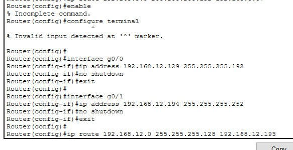
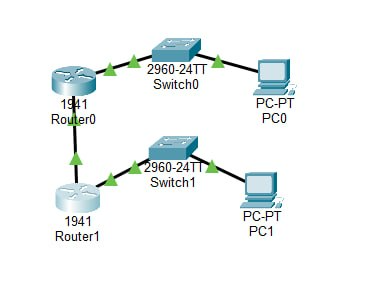
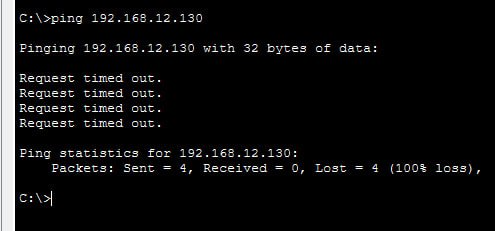

# Практичне заняття №8 — варіант 12
## IPv4-адресація, маски, підмережі та VLSM

**Базова мережа:** `192.168.12.0/24`  
**Потреби:** A — 95 вузлів; Б — 45 вузлів; P2P — 2 вузли.

## 1. Базова мережа
- Маска: `255.255.255.0`
- Загальна кількість адрес: `2^(32−24) = 256`
- Придатних адрес вузлів: `256 − 2 = 254`
- Адреса мережі: `192.168.12.0`
- Broadcast: `192.168.12.255`
- Діапазон вузлів: `192.168.12.1–192.168.12.254`

## 2. Дві підмережі однакового розміру
Для двох підмереж позичаємо 1 біт: `/24 → /25`, маска `255.255.255.128`. Кожна має 128 загальних і 126 придатних адрес.

| № | Мережа | Маска | Діапазон вузлів | Broadcast |
|---|---|---|---|---|
| 1 | `192.168.12.0/25` | `255.255.255.128` | `192.168.12.1–192.168.12.126` | `192.168.12.127` |
| 2 | `192.168.12.128/25` | `255.255.255.128` | `192.168.12.129–192.168.12.254` | `192.168.12.255` |

## 3. VLSM-таблиця

| Сегмент | Потреба | Префікс | Маска | Адреса мережі | Діапазон вузлів | Broadcast |
|---|---:|---|---|---|---|---|
| A | 95 | `/25` | `255.255.255.128` | `192.168.12.0` | `192.168.12.1–192.168.12.126` | `192.168.12.127` |
| Б | 45 | `/26` | `255.255.255.192` | `192.168.12.128` | `192.168.12.129–192.168.12.190` | `192.168.12.191` |
| P2P | 2 | `/30` | `255.255.255.252` | `192.168.12.192` | `192.168.12.193–192.168.12.194` | `192.168.12.195` |

### Обґрунтування префіксів
- A: `/26` дає 62 хости — замало; `/25` дає 126 — достатньо.
- Б: `/27` дає 30 хостів — замало; `/26` дає 62 — достатньо.
- P2P: `/30` дає 2 придатні адреси — рівно для двох кінців каналу.

### Перевірка
- A займає `.0–.127`, Б — `.128–.191`, P2P — `.192–.195`.
- Перекриттів немає; блоки вирівняні за розміром і містяться в `192.168.12.0/24`.
- Використано `128 + 64 + 4 = 196` адрес із 256; залишається 60 адрес (`192.168.12.196–192.168.12.255`) як вільний діапазон, але майбутні підмережі мають відповідати своїм межам.
- Запас придатних адрес: A — `126 − 95 = 31`; Б — `62 − 45 = 17`; P2P — `2 − 2 = 0`.

## 4. План адресації Packet Tracer

| Пристрій / інтерфейс | IP | Маска | Шлюз |
|---|---|---|---|
| R1 — LAN A | `192.168.12.1` | `255.255.255.128` | — |
| PC-A | `192.168.12.10` | `255.255.255.128` | `192.168.12.1` |
| R1 — LAN Б | `192.168.12.129` | `255.255.255.192` | — |
| PC-Б | `192.168.12.130` | `255.255.255.192` | `192.168.12.129` |
| R1 — P2P до R2 | `192.168.12.193` | `255.255.255.252` | — |
| R2 — P2P до R1 | `192.168.12.194` | `255.255.255.252` | — |

### Команди R1 
```text
enable
configure terminal
hostname R1
interface gigabitEthernet0/0
 description LAN_A
 ip address 192.168.12.1 255.255.255.128
 no shutdown
exit
interface gigabitEthernet0/1
 description LAN_B
 ip address 192.168.12.129 255.255.255.192
 no shutdown
exit
interface gigabitEthernet0/2
 description P2P_TO_R2
 ip address 192.168.12.193 255.255.255.252
 no shutdown
exit
end
show ip interface brief
show ip route
```
Назви інтерфейсів залежать від обраної моделі маршрутизатора. Для P2P на R2 налаштуйте інтерфейс `192.168.12.194/30` і виконайте `no shutdown`.

### Перевірка
- PC-A: `ping 192.168.12.1`
- PC-Б: `ping 192.168.12.129`
- PC-A: `ping 192.168.12.130` — перевірка міжсегментної маршрутизації.
- R1: `ping 192.168.12.194` — перевірка P2P.
## Скріни виконаної роботи 







## 5. Відповіді на контрольні запитання

1. **Чому AND?** Операція AND між адресою і маскою зберігає мережеві біти й обнуляє вузлові, отримуючи адресу мережі.
2. **Що змінюється при переході з /24 на /25?** Придатних адрес стає 126 замість 254.
3. **Однаковий поділ і VLSM:** у першому випадку всі підмережі одного розміру; VLSM дозволяє різні префікси відповідно до потреб.
4. **Чому починають з найбільшої?** Це зменшує фрагментацію адресного простору й допомагає розміщувати великі блоки на правильних межах.
5. **Чому P2P /30?** Він має чотири адреси загалом, з яких дві придатні для двох кінців каналу, тому не витрачається більший блок.

## 6. Домашнє завдання

VLSM починають із найбільшої потреби, щоб спершу виділити найбільший безперервний блок. Блоки повинні бути вирівняні на межах розміру: `/25` — крок 128 адрес, `/26` — 64, `/30` — 4. Якщо спочатку розмістити малі підмережі довільно, вони можуть зайняти межі, потрібні великому блоку, або фрагментувати простір так, що великий блок не поміститься без перекриття чи виходу за межі бази.

У сегменті A потрібно 95 вузлів, а `/25` надає 126 придатних адрес, тому запас становить `126 − 95 = 31`. Це нормально: розмір підмережі визначається степенями двійки, а запас дозволяє подальше зростання.


