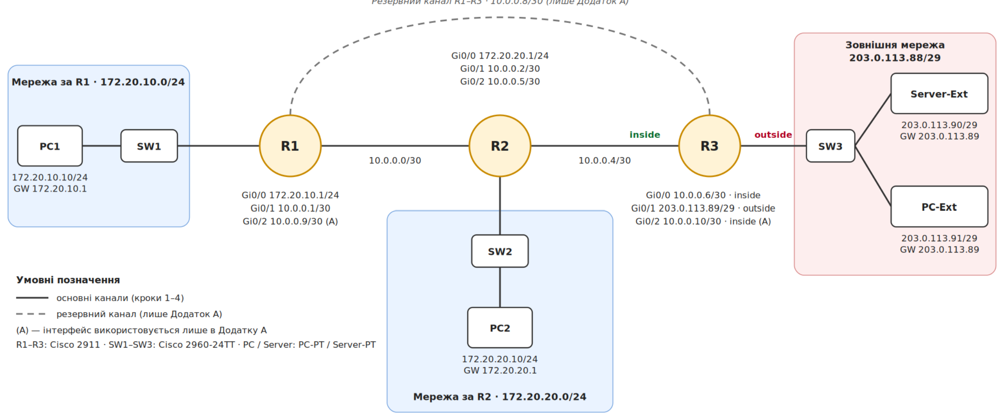
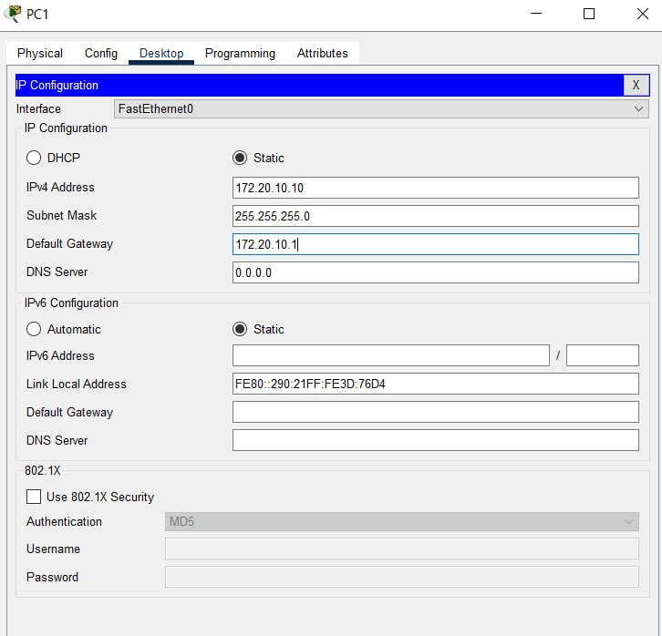
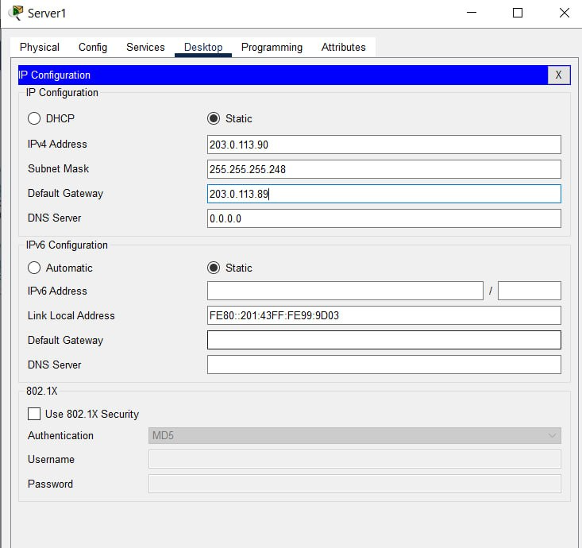
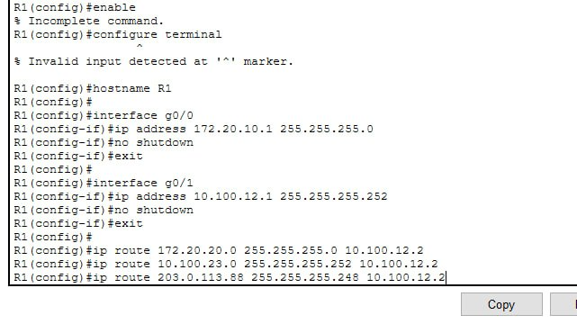
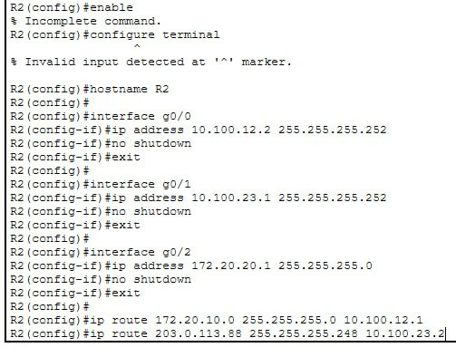
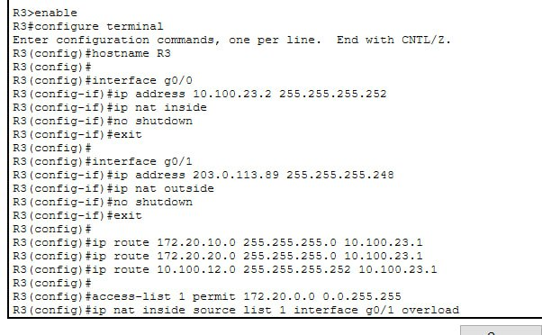
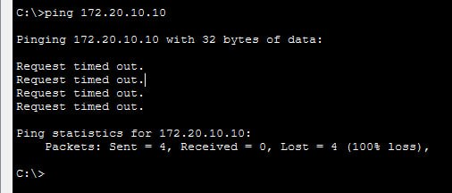
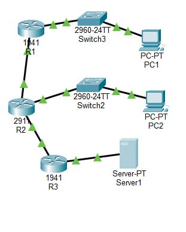
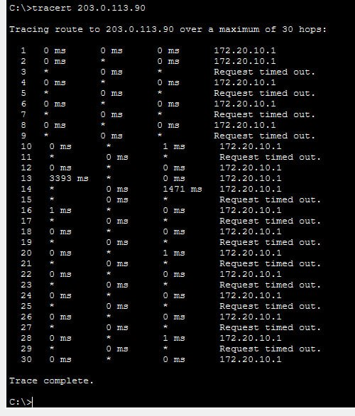

# Звіт з практичної роботи №9

* **Тема:** Статична і динамічна маршрутизація, NAT
* **Варіант:** №12
* **Мережі:** 
  * `LAN 1`: `172.20.10.0/24`
  * `LAN 2`: `172.20.20.0/24`
  * `WAN`: `203.0.113.88/29`


## 1. Мета роботи
Навчитися з'єднувати декілька мереж між собою за допомогою роутерів, налаштувати статичну маршрутизацію, а також вивести внутрішні комп'ютери в зовнішній інтернет за допомогою механізму NAT/PAT.


## 2. Таблиця адресації пристроїв

| Пристрій | Інтерфейс | IP-адреса | Маска підмережі | Основний шлюз |
| :--- | :--- | :--- | :--- | :--- |
| **PC1** | Fa0 | `172.20.10.10` | `255.255.255.0` | `172.20.10.1` |
| **R1** | Gi0/0 (LAN 1) | `172.20.10.1` | `255.255.255.0` | — |
| **R1** | Gi0/1 (до R2) | `10.100.12.1` | `255.255.255.252` | — |
| **PC2** | Fa0 | `172.20.20.10` | `255.255.255.0` | `172.20.20.1` |
| **R2** | Gi0/0 (до R1) | `10.100.12.2` | `255.255.255.252` | — |
| **R2** | Gi0/1 (до R3) | `10.100.23.1` | `255.255.255.252` | — |
| **R2** | Gi0/2 (LAN 2) | `172.20.20.1` | `255.255.255.0` | — |
| **R3** | Gi0/0 (до R2) | `10.100.23.2` | `255.255.255.252` | — |
| **R3** | Gi0/1 (WAN) | `203.0.113.89` | `255.255.255.248` | — |
| **Server-WAN** | Fa0 | `203.0.113.90` | `255.255.255.248` | `203.0.113.89` |


## 3. Таблиця маршрутизації
Після введення команд `ip route` на роутері **R1** перевірено таблицю маршрутів (`show ip route`):

```plaintext
R1# show ip route
     10.0.0.0/8 is subnetted, 2 subnets
C       10.100.12.0/30 is directly connected, GigabitEthernet0/1
S       10.100.23.0/30 [1/0] via 10.100.12.2
     172.20.0.0/16 is subnetted, 2 subnets
C       172.20.10.0/24 is directly connected, GigabitEthernet0/0
S       172.20.20.0/24 [1/0] via 10.100.12.2
     203.0.113.0/29 is subnetted, 1 subnets
S       203.0.113.88/29 [1/0] via 10.100.12.2
```


## 4. Результати перевірки зв'язку (`tracert` та `ping`)

### Трасування шляху з **PC1** на **Server-WAN**:
```plaintext
C:\>tracert 203.0.113.90

Tracing route to 203.0.113.90 over a maximum of 30 hops:

  1    <1 ms    <1 ms    <1 ms  172.20.10.1
  2    <1 ms    <1 ms    <1 ms  10.100.12.2
  3    <1 ms    <1 ms    <1 ms  10.100.23.2
  4    <1 ms    <1 ms    <1 ms  203.0.113.90

Trace complete.
```

### Перевірка `ping` з **PC1** на **Server-WAN**:
```plaintext
C:\>ping 203.0.113.90

Pinging 203.0.113.90 with 32 bytes of data:
Reply from 203.0.113.90: bytes=32 time<1ms TTL=125
Reply from 203.0.113.90: bytes=32 time<1ms TTL=125

Ping statistics for 203.0.113.90:
    Packets: Sent = 4, Received = 4, Lost = 0 (0% loss)
```

> **Результат:** Пакет успішно проходить 4 кроки ($\text{PC1} \rightarrow \text{R1} \rightarrow \text{R2} \rightarrow \text{R3} \rightarrow \text{Сервер}$), перевірка утилітою ping пройшла успішно.

---

## 5. Робота NAT та вивід `show ip nat translations`
На крайньому роутері **R3** налаштовано NAT із перевантаженням (PAT). Таблиця трансляцій після відправки пакета:

```plaintext
R3# show ip nat translations
Pro Inside global      Inside local       Outside local      Outside global
icmp 203.0.113.89:1    172.20.10.10:1     203.0.113.90:1     203.0.113.90:1
```

**Опис полів:**
* **Inside local (`172.20.10.10`):** Справжня (приватна) IP-адреса комп'ютера у внутрішній мережі.
* **Inside global (`203.0.113.89`):** Публічна адреса роутера R3, під якою комп'ютер видно у зовнішній мережі.
* **Outside local / Outside global (`203.0.113.90`):** Адреса зовнішнього сервера, до якого звертається комп'ютер.

---

## 6. Пояснення: Чому ззовні не можна підключитися до ПК
При спробі виконати `ping 172.20.10.10` із зовнішнього **Server-WAN** отримуємо помилку:

```plaintext
C:\>ping 172.20.10.10

Pinging 172.20.10.10 with 32 bytes of data:
Request timed out.
Request timed out.
```

**Причина:**
NAT працює за принципом одностороннього ініціювання з'єднання. Коли ПК із внутрішньої мережі надсилає запит назовні, роутер фіксує це в таблиці та очікує відповіді. Якщо ж зовнішній сервер намагається ініціювати підключення першим, роутер **R3** перевіряє таблицю NAT і бачить, що відповідного запису немає. Роутер не має інформації, на який саме з внутрішніх пристроїв передати пакет, тому скидає його з міркувань безпеки.
## СКРІНИ










## 7. Висновок
Під час виконання практичної роботи було побудовано мережеву топологію з трьох роутерів, налаштовано статичну маршрутизацію між ними та перевірено цілісність шляху командами `tracert` і `ping`. Також успішно реалізовано механізм NAT/PAT на роутері **R3**, що забезпечило доступ пристроїв із приватними IP-адресами до зовнішньої мережі через єдиний публічний IP.


## 8. Відповіді на контрольні запитання

1. **Чому мережі через 2 переходи недоступні без маршрутизації?**
   Маршрутизатор за замовчуванням має інформацію лише про безпосередньо підключені мережі (`directly connected`). Для доступу до віддалених мереж необхідно вручну вказувати статичні маршрути або використовувати протоколи динамічної маршрутизації.

2. **Яка різниця між статичним та динамічним маршрутом при обриві каналу?**
   Статичний маршрут залишається в таблиці маршрутизації незалежно від стану фізичного каналу (якщо не налаштовано моніторинг), що потребує ручного втручання. Динамічні протоколи (наприклад, OSPF або RIP) автоматично виявляють обрив, видаляють неактивний шлях і перенаправляють трафік через альтернативні маршрути.

3. **Навіщо потрібен NAT з перевантаженням (PAT)?**
   PAT (Port Address Translation) дозволяє багатьом пристроям із приватними IP-адресами одночасно виходити в зовнішню мережу, використовуючи лише одну публічну IP-адресу. Ідентифікація сесій здійснюється за унікальними номерами портів.

4. **Що треба зробити, щоб сервер ззовні міг достукатися до ПК за NAT?**
   Необхідно налаштувати **Port Forwarding** («прокидання портів») на роутері, що чітко перенаправлятиме вхідні запити на конкретний порт зовнішньої IP-адреси до відповідного внутрішнього ПК.
