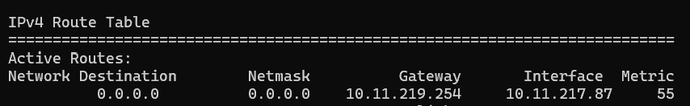
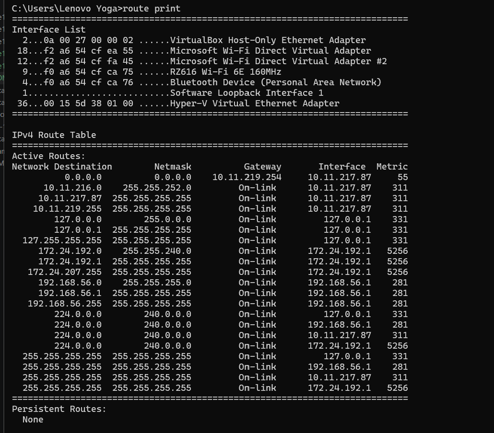
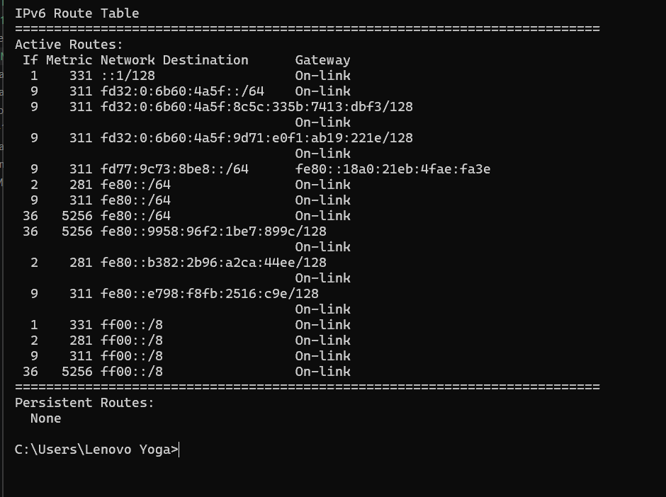

 # Лекція №16

## Контрольні запитання

### 1. Чим маршрутизатор принципово відрізняється від комутатора?
**Відповідь:** Маршрутизатор (router) працює на **мережевому рівні (L3)** моделі OSI й пересилає пакети між різними відокремленими мережами на основі IP-адрес призначення. На відміну від нього, комутатор (switch) працює на **канальному рівні (L2)** і пересилає кадри всередині однієї локальної мережі на основі MAC-адрес. Крім того, маршрутизатор розділяє домени широкомовлення (broadcast domains), тоді як комутатор передає широкомовний трафік усім пристроям у мережі.


### 2. Що таке правило найдовшого збігу префікса і навіщо воно потрібне?
**Відповідь:** **Правило найдовшого збігу префікса (Longest Prefix Match)** — це алгоритм, за яким маршрутизатор обирає відповідний маршрут із таблиці маршрутизації. Якщо IP-адреса призначення пакета відповідає кільком записам у таблиці, маршрутизатор обирає той запис, який має **найдовшу маску підмережі (найбільший префікс)**. Це потрібно для того, щоб пакет направлявся за найбільш конкретним і точним маршрутом до цільової мережі, а не за загальним.


### 3. Порівняйте RIP і OSPF за метрикою та швидкістю збіжності.
**Відповідь:** * **Метрика:** * **RIP:** Використовує просту метрику — **кількість хопів (hop count)**, тобто кількість маршрутизаторів на шляху (максимум 15). Швидкість і пропускна здатність каналів не враховуються.
  * **OSPF:** Використовує метрику **вартість (Cost)**, яка обчислюється на основі пропускної здатності (швидкості) каналів зв'язку ($Cost = \frac{10^8}{\text{bandwidth}}$).
* **Швидкість збіжності (Convergence):** * **RIP:** Має **повільну збіжність**, оскільки періодично (кожні 30 секунд) розсилає всю свою таблицю маршрутизації сусіднім маршрутизаторам.
  * **OSPF:** Має **дуже високу (швидку) збіжність**, оскільки миттєво розсилає повідомлення про зміни стану ліній (LSA) тільки при виникненні змін у топології.


### 4. Яку роль відіграє BGP на рівні глобального інтернету?
**Відповідь:** **BGP (Border Gateway Protocol)** є основним протоколом міждоменної маршрутизації (EGP) у світі. Він з'єднує між собою тисячі автономних систем (AS) — провайдерів інтернет-послуг (ISP), великих корпорацій та дата-центрів. BGP обмінюється інформацією про доступність IP-префіксів між автономними системами та будує глобальні маршрути передачі даних у масштабі всього Інтернету.


### 5. У чому різниця між статичним NAT, динамічним NAT і PAT?
**Відповідь:** * **Статичний NAT (Static NAT):** Встановлює постійне відображення **1:1** — одна приватна IP-адреса суворо відповідає одній публічній IP-адресі. Використовується для серверів.
* **Динамічний NAT (Dynamic NAT):** Встановлює тимчасове відображення **M:N** — приватні IP-адреси динамічно отримують вільну публічну IP-адресу з виділеного пулу за принципом "перший прийшов — перший отримав".
* **PAT (Port Address Translation / NAPT / Overload):** Встановлює відображення **N:1** — безліч приватних IP-адрес транслюються в **одну** публічну IP-адресу за рахунок відстеження унікальних номерів портів джерела (L4).


### 6. Чому вхідне з’єднання до вузла за NAT потребує проброс порту?
**Відповідь:** Вузол у локальній мережі за NAT має приватну IP-адресу, яку не видно із зовнішнього Інтернету. Коли зовнішній клієнт ініціює з'єднання, роутер отримує пакет на свою публічну IP-адресу, але не знає, якому саме внутрішньому пристрою цей пакет призначено, оскільки в таблиці NAT немає попередньо створеного запису.  
**Проброс порту (Port Forwarding)** створює статичне правило на роутері: "усі вхідні запити на зовнішній порт $X$ перенаправляти на внутрішню IP-адресу $Y$ та порт $Z$".


### 7. Чому статичний маршрут не реагує на обрив каналу, а динамічний - реагує?
**Відповідь:** * **Статичний маршрут:** Вписується в таблицю маршрутизації адміністратором вручну. Маршрутизатор продовжує надсилати пакети у вказаний напрямок, навіть якщо сусідній роутер або канал далі за лінією вийшов з ладу (якщо тільки безпосередній фізичний інтерфейс роутера не вимкнувся).
* **Динамічний маршрут:** Формується протоколами маршрутизації (RIP, OSPF тощо), які постійно обмінюються службовими пакетами (Hello-пакетами). При обриві каналу протокол автоматично виявляє втрату зв'язку, видаляє недійсний маршрут із таблиці та перераховує обхідний шлях.

### 8. У прикладі з розділу 4 RIP і OSPF обрали різні шляхи від A до E. Поясніть, чому саме так сталося і який шлях економічно вигідніший.
**Відповідь:** * **Чому так сталося:** * **RIP** розраховує маршрут за кількістю хопів. Він обрав коротший шлях за кількістю маршрутизаторів (наприклад, напряму через 1 повільний хоп).
  * **OSPF** розраховує маршрут за сумарною вартістю (Cost), яка залежить від швидкості каналів. Він обрав шлях через більше число маршрутизаторів, але через високошвидкісні канали.
* **Який шлях економічно вигідніший:** Вигіднішим є шлях, обраний **OSPF**. Незважаючи на більшу кількість проміжних вузлів, передача даних по високошвидкісних каналах відбувається значно швидше, забезпечуючи вищу пропускну здатність та менші затримки (latency).


### 9. Які поля показує команда show ip nat translations і що означає кожне з них?
**Відповідь:** Команда показує таблицю трансляції NAT, яка містить чотири основних поля:
1. **Inside local:** Приватна IP-адреса та номер порту внутрішнього пристрою в локальній мережі.
2. **Inside global:** Публічна IP-адреса та номер порту, під якими внутрішній пристрій видно із зовнішньої мережі після трансляції.
3. **Outside local:** IP-адреса та номер порту зовнішнього ресурсу, як їх бачить внутрішній хост.
4. **Outside global:** Реальна публічна IP-адреса та номер порту зовнішнього ресурсу в Інтернеті.

---

## Домашнє завдання

### Завдання 1. Визначення маршруту за правилом найдовшого збігу префікса (Longest Prefix Match)

**Записи в таблиці маршрутизації:**
1. `10.0.0.0/8`
2. `10.20.0.0/16`
3. `10.20.5.0/24`
4. `0.0.0.0/0` (Default route)

**Адреса призначення пакета:** `10.20.5.10`

**Обчислення та перевірка збігів:**
* `0.0.0.0/0` — збігається 0 бітів (префікс `/0`).
* `10.0.0.0/8` — збігається перший октет (`10`), префікс `/8`.
* `10.20.0.0/16` — збігаються перші два октети (`10.20`), префікс `/16`.
* `10.20.5.0/24` — збігаються перші три октети (`10.20.5`), префікс `/24`.

**Рішення та висновок:** Буде обрано запис **`10.20.5.0/24`**.  
*Обґрунтування:* Усі чотири записи відповідають адресі `10.20.5.10`, але згідно з правилом **Longest Prefix Match** маршрутизатор завжди обирає маршрут з найдовшою маскою підмережі (найбільшим префіксом). Префікс `/24` є найдовшим серед усіх наявних (`/24 > /16 > /8 > /0`), оскільки він описує найбільш конкретну підмережу.


# Завдання 2. Перегляд таблиці маршрутизації на власному комп'ютері

**Команда, виконана в командному рядку ОС Windows:**
```cmd
route print
```
##  Фрагмент виведення таблиці маршрутизації

**Звіт за результатами виконання:**
- **Запис default route:** `0.0.0.0` з маскою `0.0.0.0`
- **Адреса шлюзу за замовчуванням (Default Gateway):** `10.11.219.254`
- **IP-адреса активного мережевого інтерфейсу:** `10.11.217.87` (адаптер RZ616 Wi-Fi 6E 160MHz)
   
   