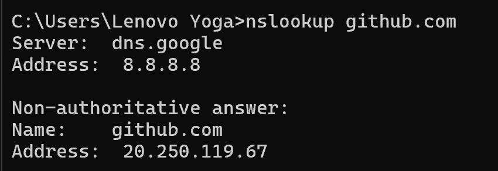
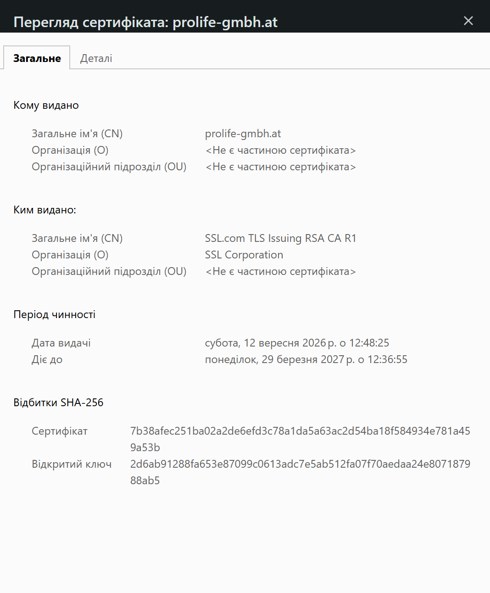

# Лекція №18. Прикладний рівень і сокети: клієнт-серверна модель, DNS, DHCP, HTTP/HTTPS

## 1. Контрольні запитання

### 1. Чим клієнт-серверна модель відрізняється від P2P?

У клієнт-серверній моделі сервер надає певну службу, а клієнт ініціює запити до неї; ролі учасників переважно фіксовані. У моделі peer-to-peer (P2P) кожен вузол може одночасно бути і клієнтом, і сервером, а служба розподіляється між учасниками без виділеного центрального сервера. Клієнт-серверний підхід поширений у вебсервісах і базах даних, а P2P — у файлообміні та деяких блокчейн-системах.

### 2. Опишіть послідовність викликів сокетного інтерфейсу на сервері.

Типова послідовність: `socket()` → `bind()` → `listen()` → `accept()` → `recv()`/`send()` → `close()`.

- `socket()` створює сокет.
- `bind()` прив’язує його до локальної IP-адреси й порту.
- `listen()` переводить сокет у режим очікування вхідних з’єднань.
- `accept()` приймає з’єднання клієнта.
- `recv()` і `send()` використовуються для отримання та надсилання даних.
- `close()` закриває сокет.

### 3. У чому різниця рекурсивного й ітеративного DNS-запиту?

Під час рекурсивного запиту клієнт просить резолвер повністю розв’язати доменне ім’я та повернути готову відповідь. Під час ітеративного запиту сервер повертає найкращу наявну відповідь або підказку, який сервер опитати далі. Тому клієнт зазвичай надсилає рекурсивний запит локальному резолверу, а сам резолвер може ітеративно звертатися до кореневих, TLD- та авторитетних DNS-серверів.

### 4. Що означають чотири кроки DHCP (DORA)?

DORA — це **Discover, Offer, Request, Acknowledge**.

1. **Discover** — клієнт шукає DHCP-сервер.
2. **Offer** — сервер пропонує IP-адресу та мережеві параметри.
3. **Request** — клієнт повідомляє, що приймає конкретну пропозицію.
4. **Acknowledge** — сервер підтверджує видачу адреси та строк оренди (лізинг).

### 5. Як HTTPS забезпечує безпеку поверх HTTP?

HTTPS — це HTTP, переданий через захищений канал TLS. TLS шифрує передані дані, допомагає забезпечити їхню цілісність і дає змогу перевірити автентичність сервера за допомогою цифрового сертифіката. Завдяки цьому сторонній учасник мережі не повинен мати змоги прочитати або непомітно змінити вміст обміну.

### 6. Чому помилка резолву DNS може виглядати як недоступність усього сервісу?

Щоб підключитися до сервісу за доменним ім’ям, пристрою потрібно отримати відповідну IP-адресу через DNS. Якщо DNS-запис неправильний, домен не існує (наприклад, `NXDOMAIN`), резолвер недоступний або в кеші збереглися застарілі дані, клієнт може не знайти адресу сервера. У такому разі сервіс може фактично працювати, але користувач не зможе до нього дістатися за доменним ім’ям.

### 7. Опишіть кроки ітеративного резолвінгу імені від кореневого сервера до авторитетного. Чим ітеративний запит відрізняється від рекурсивного з погляду резолвера і з погляду клієнта?

Спочатку клієнт надсилає локальному резолверу рекурсивний запит для `www.example.ua`. Резолвер звертається до кореневого DNS-сервера й отримує посилання на сервер домену верхнього рівня `.ua`. Далі він звертається до TLD-сервера `.ua` та отримує посилання на авторитетний сервер домену `example.ua`. Авторитетний сервер повертає потрібний запис, наприклад A-запис з IPv4-адресою та TTL. Резолвер передає готову відповідь клієнту й може кешувати її на час TTL.

Для клієнта запит є рекурсивним, бо він очікує готовий результат; між DNS-серверами резолвер виконує ітеративні запити, послідовно переходячи за підказками.

### 8. Що відбувається під час поновлення оренди DHCP (lease renewal) і чому воно не потребує повторного Discover?

До завершення лізингу клієнт, зазвичай приблизно після половини строку оренди, надсилає DHCP `Request` безпосередньо серверу, який видав адресу. Якщо сервер підтверджує запит повідомленням DHCP `Acknowledge`, оренда продовжується, а IP-адреса зазвичай залишається тією самою. Повторний `Discover` не потрібний, оскільки клієнт уже знає сервер, який видав адресу, і намагається поновити наявну оренду, а не шукати новий сервер.

### 9. Чим відрізняються коди стану 401 і 403, а також 502 і 503?

- **401 Unauthorized** — потрібна автентифікація або надані облікові дані не дозволяють її успішно пройти.
- **403 Forbidden** — сервер зрозумів запит, але відмовляє в доступі; навіть після автентифікації доступ може бути заборонений.
- **502 Bad Gateway** — проксі або шлюз отримав недійсну відповідь від сервера, до якого звертався.
- **503 Service Unavailable** — сервер тимчасово не може обробити запит, наприклад через перевантаження або технічне обслуговування.

## 2. Домашнє завдання

### Завдання 1. Перевірка DNS-записів `github.com`

Для перевірки DNS у командному рядку можна використати:

```bash
nslookup github.com
```

Або, якщо встановлено утиліту `dig`:

```bash
dig github.com A
```

Команда повертає один або кілька IPv4-адрес (A-записів) домену `github.com`. Набір адрес може змінюватися залежно від часу, DNS-резолвера та мережевого розташування. У звичайному виводі `nslookup` TTL може не відображатися; `dig` зазвичай показує TTL у секції `ANSWER`.

### Завдання 2. Послідовність DORA під час підключення до нової Wi-Fi мережі

1. **Discover.** Надсилач — ноутбук (DHCP-клієнт); отримувач — DHCP-сервери в локальній мережі. Клієнт зазвичай надсилає широкомовний запит, оскільки ще не має виданої адреси та не знає, який DHCP-сервер відповість.
2. **Offer.** Надсилач — DHCP-сервер; отримувач — ноутбук. Сервер пропонує вільну IP-адресу та параметри мережі: маску підмережі, шлюз, DNS-сервери й строк оренди.
3. **Request.** Надсилач — ноутбук; отримувач — DHCP-сервери, зазвичай через широкомовне повідомлення на етапі первинного отримання адреси. Клієнт указує, яку запропоновану адресу й сервер обирає.
4. **Acknowledge.** Надсилач — обраний DHCP-сервер; отримувач — ноутбук. Сервер підтверджує оренду адреси й передавання мережевих параметрів.

### Завдання 3. Помилка в твердженні про GET і форму реєстрації

Твердження «HTTP-запит GET використовується для надсилання форми реєстрації користувача на сервер» є неправильним як загальне правило. Метод `GET` призначений переважно для отримання ресурсу й не повинен використовуватися для операцій, що змінюють стан сервера. Параметри `GET` часто передаються в URL, де вони можуть зберігатися в історії браузера, потрапляти в журнали сервера або передаватися далі через посилання.

Для надсилання реєстраційних даних, що створюють обліковий запис і змінюють стан сервера, зазвичай використовують `POST`, передаючи дані в тілі запиту. Реєстраційна форма має надсилатися через HTTPS, щоб захистити дані під час передавання.

## 3. Закріплення теми

1. **Клієнт-серверна модель** має окремий сервер, який надає службу клієнтам; у P2P вузли можуть виконувати обидві ролі.
2. **Сокети на сервері:** `socket()` → `bind()` → `listen()` → `accept()` → `send()`/`recv()` → `close()`.
3. **DNS** перетворює доменні імена на IP-адреси. Рекурсивний запит вимагає готової відповіді, а ітеративний дає відповідь або підказку для наступного звернення.
4. **DHCP** автоматично надає IP-адресу та інші параметри мережі за схемою DORA: Discover, Offer, Request, Acknowledge.
5. **HTTP** використовує модель запит-відповідь. `GET` отримує ресурс, `POST` зазвичай надсилає дані для створення ресурсу або виконання операції, `PUT` замінює ресурс, `PATCH` частково його змінює, `DELETE` видаляє.
6. **HTTPS** передає HTTP через TLS, забезпечуючи шифрування, цілісність даних та автентифікацію сервера.
7. **TTL** визначає, як довго DNS-відповідь може зберігатися в кеші. Тому зміни DNS-записів можуть ставати видимими не миттєво.
8. **Коди стану HTTP:** 401 — потрібна автентифікація; 403 — доступ заборонено; 502 — недійсна відповідь від сервера, до якого звернувся шлюз; 503 — тимчасова недоступність служби.

# Підготовка до наступного заняття (Лекція №19)

## Тема: Безпека передавання даних і цифрові сертифікати HTTPS/TLS

### Мета роботи

Ознайомитися з роботою захищеного протоколу HTTPS, дізнатися про призначення цифрових сертифікатів і перевірити сертифікат безпеки вебсайту.

### Хід роботи

1. Відкрила вебсайт [https://www.prolife-gmbh.at/](https://www.prolife-gmbh.at/).
2. Перевірила інформацію про безпеку з’єднання та відкрила вікно перегляду цифрового сертифіката.
3. Переглянула загальні відомості про сертифікат, зокрема його власника, видавця та період чинності.
4. Записала отримані дані.

### Результати перевірки цифрового сертифіката

- **Сайт:** prolife-gmbh.at
- **Протокол:** HTTPS
- **Загальне ім’я сертифіката (CN):** prolife-gmbh.at
- **Видавець сертифіката (Certificate Authority):** SSL.com TLS Issuing RSA CA R1
- **Організація видавця:** SSL Corporation
- **Дата початку дії сертифіката:** 12 вересня 2026 року о 12:48:25
- **Дата завершення дії сертифіката:** 29 березня 2027 року о 12:36:55


### Теоретичні відомості

HTTP — це протокол передавання даних між браузером і вебсервером. Сам по собі він не забезпечує шифрування інформації.

HTTPS — це захищена версія HTTP, яка використовує протокол TLS для шифрування даних під час передавання мережею. Це допомагає захистити інформацію від перехоплення та непомітної зміни.

Цифровий сертифікат підтверджує зв’язок між доменним ім’ям сайту та його відкритим ключем. Він також допомагає браузеру перевірити справжність сервера. Сертифікат видається центром сертифікації (Certificate Authority, CA) і має визначений термін дії.

Під час перевірки сертифіката браузер враховує його чинність, відповідність домену та довіру до центру сертифікації. Якщо виникають проблеми з перевіркою, браузер може показати попередження про безпеку з’єднання.


