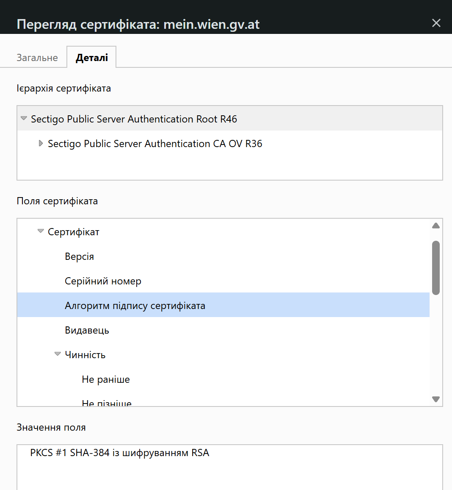
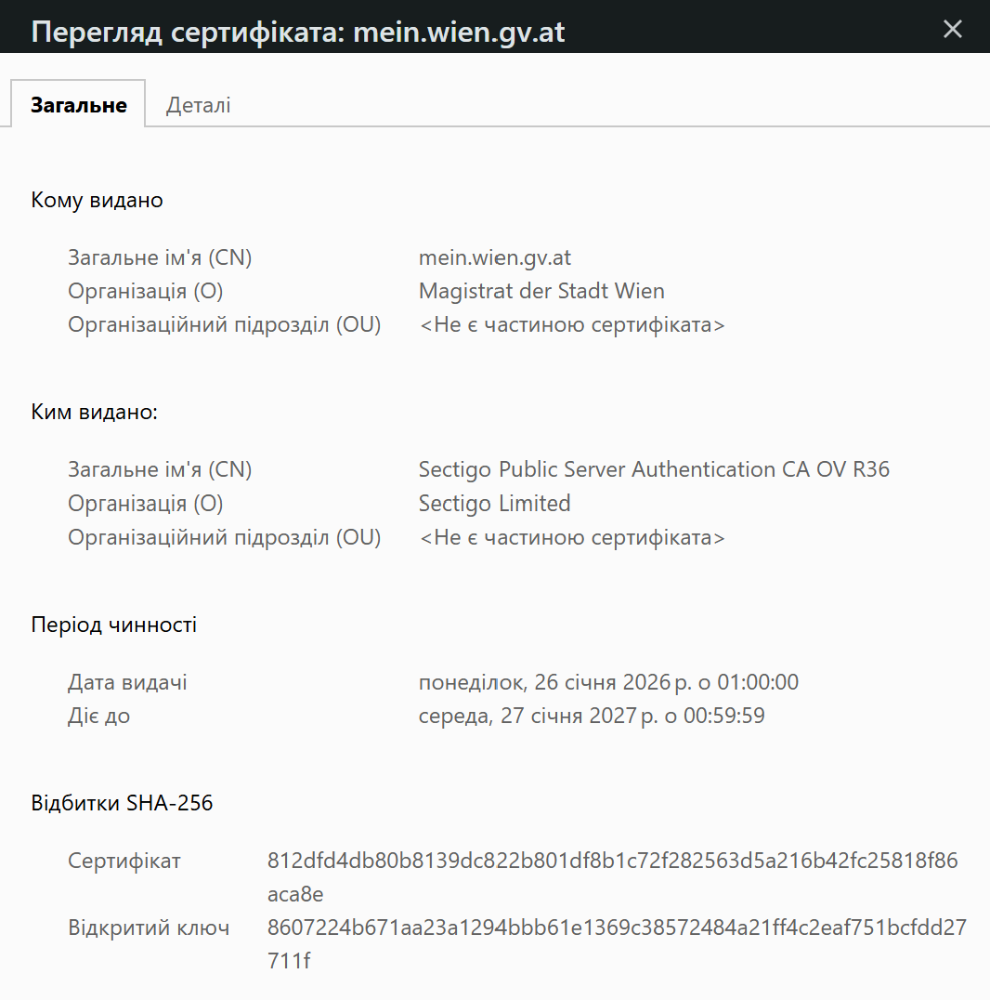

# Лекція №19 — Бездротові мережі та мережева безпека

##  Відповіді на контрольні запитання

### 1. Чим CSMA/CA відрізняється від виявлення колізій у дротових мережах?

CSMA/CA намагається уникнути колізій: пристрій прослуховує канал перед передаванням і чекає, якщо канал зайнятий. У дротовому CSMA/CD пристрої могли виявляти колізію під час передавання. У бездротовому середовищі надійно виявити колізію під час власного передавання складно, тому застосовують уникнення колізій.

### 2. У чому суть проблеми прихованого вузла?

Два клієнти не чують один одного, але обидва чують точку доступу. Кожен може вважати канал вільним і почати передавання одночасно, через що пакети можуть зіткнутися на точці доступу.

### 3. Чому WEP вважається непридатним, а WPA3 — сучасним стандартом?

WEP використовує застарілий криптографічний механізм і статичний ключ, тому його можна зламати за короткий час. WPA3 застосовує сучасніші механізми захисту та SAE, який ускладнює офлайн-підбір пароля.

### 4. Поясніть різницю між симетричним і асиметричним шифруванням.

Симетричне шифрування використовує один спільний ключ для шифрування та розшифрування й працює швидко. Асиметрична криптографія використовує відкритий і закритий ключі; вона допомагає узгоджувати секрети та перевіряти цифрові підписи. У TLS ці підходи комбінуються.

### 5. Опишіть у загальних рисах рукостискання TLS.

Клієнт надсилає підтримувані параметри, сервер обирає їх і надсилає сертифікат. Клієнт перевіряє сертифікат, після чого сторони узгоджують спільний секрет і формують ключі сеансу. Далі дані передаються із симетричним шифруванням.

### 6. Чому не можна вимикати перевірку сертифіката в клієнтському коді?

Сертифікат допомагає перевірити, що клієнт з’єднується зі справжнім сервером. Якщо вимкнути перевірку, зловмисник може видати себе за сервер і перехоплювати або змінювати дані, наприклад під час атаки MITM.

### 7. Чим TLS 1.3 відрізняється від TLS 1.2 за кількістю раундів рукостискання і чому це прискорює з’єднання?

Звичайне рукостискання TLS 1.2 потребує двох раундів обміну (2-RTT), а TLS 1.3 — одного (1-RTT). Менша кількість раундів зменшує затримку перед початком захищеного обміну даними.

### 8. Яку помилку покаже браузер, якщо термін дії сертифіката минув, а яку — якщо видавцю сертифіката не довіряють?

Якщо сертифікат прострочений або ще не почав діяти, типовий код — `NET::ERR_CERT_DATE_INVALID`. Якщо браузер не довіряє видавцю, типовий код — `NET::ERR_CERT_AUTHORITY_INVALID`.

### 9. Опишіть механізм ARP-спуфінгу в локальній мережі та щонайменше один контрзахід проти нього.

Під час ARP-спуфінгу зловмисник надсилає підроблені ARP-відповіді, у яких його MAC-адреса пов’язується з IP-адресою шлюзу. Пристрої можуть почати надсилати трафік через зловмисника. Для захисту використовують DHCP snooping і Dynamic ARP Inspection на комутаторах або статичні ARP-записи для критичних вузлів.

### 10. Чим відрізняється обсяг трафіку, який захищає VPN, від обсягу, який захищає TLS?

TLS захищає конкретне з’єднання застосунку із сервером, наприклад браузер із вебсайтом. VPN створює зашифрований тунель між пристроєм і VPN-шлюзом та захищає трафік пристрою, що проходить через цей тунель.

### 11. Яку роль виконує 4-way handshake у WPA2 і чому пароль мережі при цьому не передається відкрито?

4-way handshake підтверджує, що клієнт і точка доступу мають потрібний спільний секрет, і дає змогу узгодити тимчасові ключі шифрування. Сторони обмінюються випадковими числами та обчисленими контрольними значеннями, а не передають сам пароль відкритим текстом.

### 12. Чому SAE у WPA3 стійкіший до офлайн-підбору пароля, ніж механізм узгодження ключа у WPA2?

SAE забезпечує рівноправне узгодження ключа між клієнтом і точкою доступу. Перехоплений обмін не дає зловмиснику такого матеріалу для офлайн-перевірки великої кількості паролів, як у вразливішому сценарії WPA2.

---

##  Домашнє завдання

### Завдання 1. Порівняльна таблиця протоколів захисту Wi-Fi

| Протокол | Алгоритм шифрування | Тип ключа | Основні вразливості |
|---|---|---|---|
| WEP | RC4 | Статичний ключ | Криптографічні слабкості, повторне використання векторів ініціалізації; злам можливий за короткий час |
| WPA2 | AES-CCMP у типовому сучасному режимі; у старих конфігураціях міг використовуватися TKIP | Динамічні сеансові ключі, що узгоджуються під час рукостискання | Слабкі паролі можуть бути вразливими до підбору; безпека залежить від конфігурації |
| WPA3 | Сучасне шифрування на основі AES-CCMP у типовому режимі WPA3-Personal | Динамічні ключі; SAE для автентифікації та узгодження ключа | Потребує сумісного обладнання й правильної конфігурації; не усуває всі можливі ризики мережі |

**Висновок:** WEP використовувати не слід. Для нових мереж потрібно обирати WPA3, якщо обладнання його підтримує; інакше — належно налаштований WPA2 із сильним унікальним паролем.

### Завдання 2. Перевірка сертифіката HTTPS-сайту

Для перевірки цифрового сертифіката було обрано сайт [https://mein.wien.gv.at/Registrieren](https://mein.wien.gv.at/Registrieren).

**Результати перевірки сертифіката:**

- **Домен:** `mein.wien.gv.at`
- **Протокол:** HTTPS
- **Кому виданий (Subject / CN):** `mein.wien.gv.at`
- **Організація власника сертифіката:** Magistrat der Stadt Wien
- **Ким виданий (Issuer):** Sectigo Public Server Authentication CA OV R36
- **Організація видавця:** Sectigo Limited
- **Дата початку дії:** 26 січня 2026 року о 01:00:00
- **Дата завершення дії:** 27 січня 2027 року о 00:59:59
- **Алгоритм підпису:** PKCS #1 SHA-384 із шифруванням RSA

**Висновок:**

Під час виконання завдання було перевірено цифровий сертифікат сайту Mein Wien. Сертифікат виданий для домену `mein.wien.gv.at`, а організацією, зазначеною у сертифікаті, є Magistrat der Stadt Wien. Видавець сертифіката — Sectigo Public Server Authentication CA OV R36, організація видавця — Sectigo Limited. Сертифікат дійсний з 26 січня 2026 року до 27 січня 2027 року. HTTPS використовує протокол TLS для шифрування даних під час передавання та допомагає перевірити справжність сервера.
### Завдання 3. Рукостискання TLS у 6 кроків

1. **ClientHello:** клієнт надсилає підтримувані версії TLS, криптографічні параметри та матеріал для узгодження ключа.
2. **Вибір параметрів:** сервер обирає версію TLS і криптографічні параметри та надсилає відповідь.
3. **Сертифікат сервера:** сервер надає цифровий сертифікат, який клієнт перевіряє за доменом, терміном дії та ланцюжком довіри.
4. **Автентифікація й узгодження секрету:** сторони використовують механізми асиметричної криптографії, зокрема криптографію з відкритим ключем і/або обмін ключами на еліптичних кривих, щоб автентифікувати сервер та узгодити спільний секрет.
5. **Формування сеансових ключів:** із узгодженого секрету сторони отримують симетричні ключі для захисту з’єднання.
6. **Захищений обмін даними:** HTTP-запити й відповіді передаються із симетричним шифруванням та перевіркою цілісності.

**Де використовуються різні види криптографії?**
- **Асиметрична криптографія:** автентифікація сервера, перевірка цифрового підпису сертифіката та узгодження секрету.
- **Симетрична криптографія:** шифрування основного потоку даних після завершення рукостискання.

---

## 4. Підготовка до наступного заняття — Лекція №20

**Тема:** Проєктування мереж, ієрархія, віртуалізація та моніторинг.

### Приклад проєкту мережі малого офісу з трьома відділами

Для малого офісу з трьома відділами я б запропонувала мережу зі структурою «зірка»: усі комп’ютери та мережеві пристрої підключаються до центрального комутатора.

**Пристрої:**
- маршрутизатор із міжмережевим екраном для підключення до інтернету;
- керований комутатор для з’єднання пристроїв офісу;
- точки доступу Wi-Fi для бездротових пристроїв;
- комп’ютери, принтери та сервер або мережеве сховище за потреби;
- джерело безперебійного живлення для основного мережевого обладнання.

**Організація мережі:**
- створити окремі VLAN для трьох відділів;
- за потреби виділити окрему VLAN для гостьового Wi-Fi та окрему — для серверів;
- налаштувати маршрутизацію між VLAN через маршрутизатор або комутатор третього рівня;
- дозволяти доступ між відділами лише там, де він необхідний.

**Принципи безпеки:**
- використовувати WPA3 або WPA2 із сильним унікальним паролем;
- застосовувати TLS/HTTPS для захисту вебз’єднань;
- налаштувати firewall і мінімізувати відкриті порти;
- надавати користувачам лише необхідні права доступу;
- регулярно оновлювати прошивки та програмне забезпечення;
- використовувати VPN для безпечного віддаленого доступу;
- зберігати резервні копії та контролювати журнали подій і стан мережі.

**Моніторинг:** контролювати доступність маршрутизатора, комутатора й точок доступу, завантаження каналів, помилки з’єднань та події безпеки. Це допоможе швидше виявляти несправності й підозрілу активність.

**Висновок:** для малого офісу доцільно використати топологію «зірка», керований комутатор, маршрутизатор із firewall і точки доступу Wi-Fi. Поділ на VLAN, надійне шифрування, обмеження доступу, оновлення та моніторинг підвищують безпеку й спрощують адміністрування мережі.
