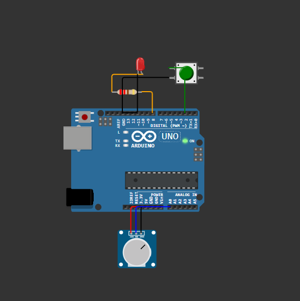
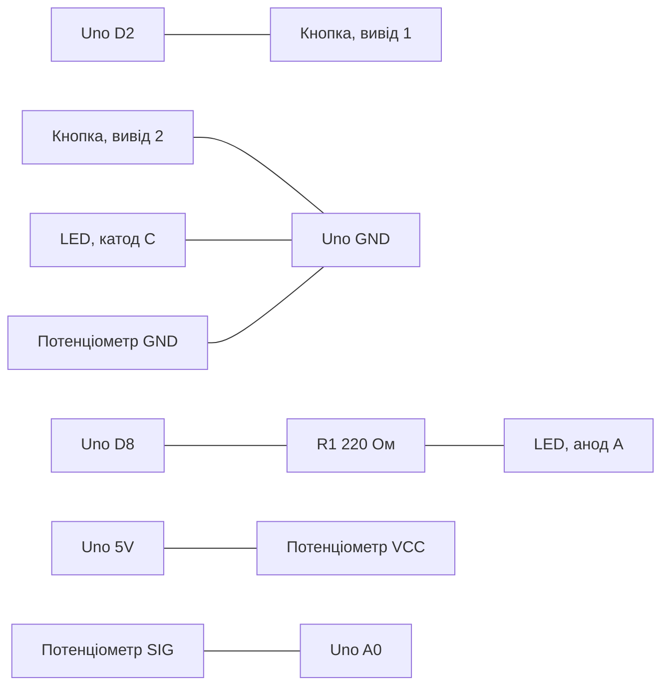
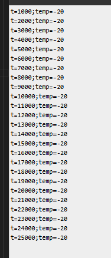

# Практичне заняття №6. Мікроконтролерний вузол: GPIO, АЦП, таймер, UART

## 1. Завдання

| Параметр | Значення |
|---|---|
| Сенсор (імітація) | Температура, діапазон −20…40 °C (потенціометр на вході A0) |
| Формат повідомлення | З міткою часу `millis()` |
| Еталонний рядок | `t=8032;temp=19` |
| Період вимірювання | 1 с, без `delay()` |
| Швидкість UART | 9600 бод |

Вимоги: кнопка (з підтягуванням) перемикає світлодіод на кожне натискання; значення `analogRead()` перетворюється на температуру через `map()`; раз на секунду в `Serial` виводиться рядок формату `t=<мс>;temp=<°C>`.

## 2. Проєкт у Wokwi


## 3. Обладнання (віртуальне)

| № | Компонент | Тип у Wokwi | Параметри |
|---|---|---|---|
| 1 | Плата Arduino Uno | `wokwi-arduino-uno` | ATmega328P, АЦП 10 біт |
| 2 | Кнопка | `wokwi-pushbutton` | підтягування - внутрішнє (`INPUT_PULLUP`) |
| 3 | Світлодіод | `wokwi-led` | червоний |
| 4 | Резистор | `wokwi-resistor` | 220 Ом (струм ≈ 14 мА) |
| 5 | Потенціометр | `wokwi-potentiometer` | імітація датчика температури |

## 4. Схема підключення


| Лінія | З'єднання | Призначення |
|---|---|---|
| Кнопка | D2 → вивід 1 кнопки; вивід 2 кнопки → GND | вхід `INPUT_PULLUP`; натиснута = `LOW` |
| Світлодіод | D8 → резистор 220 Ом → анод (A); катод (C) → GND | вихід `OUTPUT` |
| Потенціометр, живлення | 5V → VCC | опорна напруга АЦП 5 В |
| Потенціометр, земля | GND → GND | спільна земля |
| Потенціометр, сигнал | SIG (рухомий контакт) → A0 | вхід АЦП, канал 0 |




## 5. Опис роботи програми

1. **GPIO.** Пін D2 налаштовано як `INPUT_PULLUP`: у стані спокою зчитується `HIGH`, натискання замикає пін на землю й дає `LOW`. Перемикання світлодіода відбувається за *фронтом* натискання (перехід `HIGH → LOW`), тому утримання кнопки не змінює стан повторно. Дребезг контактів відфільтровується без `delay()`: нове значення приймається, лише якщо воно стабільне щонайменше 50 мс (`debounceDelay`).
2. **АЦП.** `analogRead(A0)` повертає ціле 0…1023 (10 біт, крок ≈ 4,88 мВ при опорній напрузі 5 В). Функція `map()` лінійно перетворює його на температуру: `temp = (ADC · 60) / 1023 − 20` (цілочисельне ділення).

   | ADC | 0 | 256 | 512 | 768 | 1023 |
   |---|---|---|---|---|---|
   | temp, °C | −20 | −5 | 10 | 25 | 40 |

3. **Таймер `millis()`.** Час зчитується один раз на початку `loop()`. Вимірювання виконується, коли `now - lastMeasurement >= 1000`. Віднімання беззнакових чисел залишається коректним і при переповненні лічильника `millis()` (приблизно через 49,7 доби). `delay()` у програмі відсутній, тому кнопка опитується тисячі разів на секунду.
4. **UART.** Рядок формується трьома викликами `Serial.print()` та одним `Serial.println()`. Службових повідомлень у порт не виводиться, щоб кожен рядок був чистою «посилкою» даних.

### Формат повідомлення

```
t=<мс від старту>;temp=<ціле, °C>\n
```

| Елемент | Значення |
|---|---|
| Роздільник полів | `;` (не трапляється у числах, на відміну від коми як десяткового розділювача) |
| Розділювач ключа й значення | `=` |
| Порядок полів | `t`, потім `temp` (фіксований) |
| Кінець повідомлення | `\n` (`Serial.println`) |
| Одиниці | `t` - мілісекунди, `temp` - градуси Цельсія |

Такий формат однозначно розбирається програмою: спершу рядок ділиться за `;`, потім кожне поле - за `=`. Пара `t` дає мітку часу для впорядкування та виявлення втрат пакетів при передаванні мережею (практичне заняття №10).

## 6. Повний текст скетчу (`sketch.ino`)

```cpp


const int buttonPin = 2;                   
const int ledPin    = 8;                   
const int sensorPin = A0; 

const unsigned long interval      = 1000;  
const unsigned long debounceDelay = 50;    
bool ledState = false;               
bool lastReading = HIGH;        
bool buttonState = HIGH;  
unsigned long lastDebounceTime = 0;       
unsigned long lastMeasurement  = 0;     

void setup() {
  pinMode(buttonPin, INPUT_PULLUP);       
  pinMode(ledPin, OUTPUT);
  digitalWrite(ledPin, LOW);
  Serial.begin(9600);                       
}

void loop() {
  unsigned long now = millis();           
  bool reading = digitalRead(buttonPin);
  if (reading != lastReading) {
    lastDebounceTime = now; 
  }
  if ((now - lastDebounceTime) >= debounceDelay && reading != buttonState) {
    buttonState = reading;              
    if (buttonState == LOW) {               
      ledState = !ledState;
      digitalWrite(ledPin, ledState);
    }
  }
  lastReading = reading;

 
  if (now - lastMeasurement >= interval) {
    lastMeasurement = now;
    int temperature = map(analogRead(sensorPin), 0, 1023, -20, 40);  

    Serial.print("t=");
    Serial.print(now);
    Serial.print(";temp=");
    Serial.println(temperature);          temp=19
  }
}
```

## 7. Результати

### Монітор порту



### Перевірка

| Перевірка | Очікуваний результат | Статус |
|---|---|---|
| Натискання кнопки | світлодіод змінює стан на протилежний при кожному натисканні | виконано |
| Утримання кнопки | стан не змінюється повторно (реакція на фронт) | виконано |
| Формат рядка | кожен рядок відповідає `t=<число>;temp=<число>` | виконано |
| Період | різниця між сусідніми `t` ≈ 1000 мс | виконано |
| Діапазон `temp` | від −20 (ADC = 0) до 40 (ADC = 1023) | виконано |
| Відсутність `delay()` | у тексті скетча виклику `delay()` немає | виконано |

## 8. Висновки

Використання `millis()` замість `delay()` не блокує головний цикл, тому мікроконтролер водночас опитує кнопку, виконує періодичне вимірювання та виводить дані, не пропускаючи подій, а `delay(1000)` на секунду «заморозив» би всю програму, включно з реакцією на кнопку. Продуманий формат виводу (фіксований порядок полів, чіткий роздільник `;`, пари `ключ=значення`, мітка часу `t`) дозволяє програмі на приймальному боці однозначно розібрати рядок, а за міткою часу - впорядкувати дані та помітити пропуски. Заздалегідь визначений формат буде повторно використано без змін при передаванні даних мережею в практичному занятті №10.

## 9. Відповіді на контрольні запитання

1. **Для чого призначений `INPUT_PULLUP` і чим він відрізняється від зовнішнього резистора?** Режим вмикає внутрішній підтягувальний резистор (приблизно 20-50 кОм) між пінами й живленням, тому незадіяний вхід стабільно читається як `HIGH`, а кнопка, під'єднана до GND, дає `LOW`. Зовнішній резистор виконує ту саму функцію, але є окремою деталлю (зазвичай 10 кОм), потребує місця на платі та дозволяє підтягувати як до живлення, так і до землі. У внутрішнього підтягування логіка інвертована: натиснута кнопка = `LOW`.
2. **Яку розрядність має АЦП Arduino Uno і в якому діапазоні повертає `analogRead()`?** 10 біт, тобто 2¹⁰ = 1024 рівні; `analogRead()` повертає цілі значення від 0 до 1023.
3. **Чому `delay()` у циклі вважається проблемним?** Функція переводить процесор у очікування, і за цей час програма не опитує кнопку, не читає датчики й не оновлює виходи. Короткі події (натискання) можуть бути пропущені, а реакція системи затримується на тривалість паузи. `millis()` дозволяє перевіряти час і виконувати кілька задач у кожному проході циклу.
4. **Чому формат повідомлення UART важливо продумати заздалегідь?** Дані розбиратиме програма, яка спирається на жорсткі правила: роздільник, порядок і назви полів, одиниці, ознаку кінця рядка. Пізніша зміна формату ламає приймальний бік; а коли той самий формат передається мережею, на нього спираються вже кілька систем. Мітка часу чи номер пакета допомагають виявити втрати й порушення порядку.
5. **Чим відрізняються синхронні й асинхронні послідовні інтерфейси?** У синхронних (SPI, I²C) окрема лінія тактового сигналу синхронізує передавач і приймач, а біти читаються за тактом. В асинхронних (UART) спільного такту немає: обидві сторони заздалегідь домовляються про швидкість (бод), а початок і кінець байта позначають стартовий і стоповий біти. Неузгоджена швидкість у UART дає «сміття» в моніторі порту.


